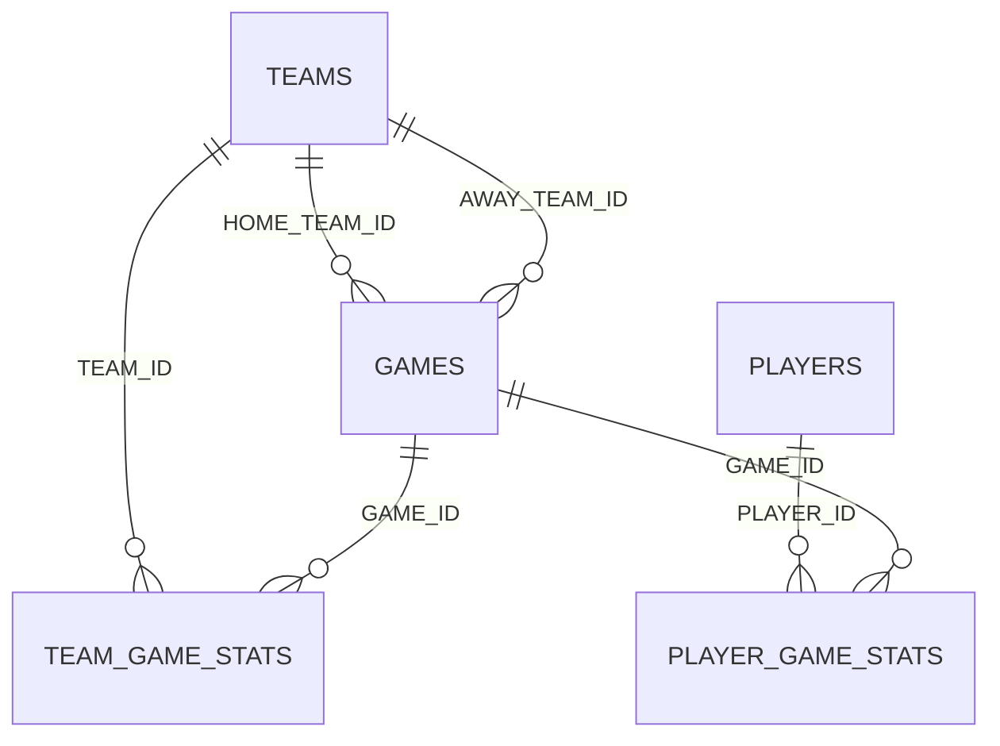

# Diccionario de datos

## Convenciones

- Los CSV son UTF-8 con BOM. Aunque CSV no conserva tipos, las columnas se
  representan con los tipos lógicos indicados abajo.
- Un valor vacío significa desconocido/no disponible; no equivale a cero.
- `NBA Stats` identifica datos que entrega el endpoint `LeagueGameLog` de NBA
  Stats mediante la librería comunitaria `nba_api`. La librería no es un
  producto oficial de NBA y el servicio no ofrece un SLA público.
- `Derivado` identifica transformaciones deterministas de valores de esa
  fuente; `Legado` datos trasladados de CSV previos; `Plantilla NBA` URLs
  construidas con IDs, no comprobadas mediante una solicitud HTTP.
- Frecuencia `cada ejecución` significa actualización cuando se ejecuta la
  extracción. Los campos estáticos del catálogo no se refrescan desde una API.
- Los datos de la temporada regular 2026-27 no incluyen estadísticas de
  playoffs. `SEASON_TYPE` separa explícitamente ambos tipos en `GAMES`.

## TEAMS (`teams.csv`)

Una fila por franquicia; clave primaria `TEAM_ID`.

| Campo | Tipo lógico | Descripción / unidad | Procedencia; carácter | Nulo | Actualización |
|---|---|---|---|---|---|
| TEAM_ID | entero | ID oficial de franquicia | NBA Stats; clave | No | Cada ejecución |
| TEAM_NAME | texto | Nombre completo | NBA Stats; variable | Sí | Cada ejecución |
| TEAM_ABBREVIATION | texto | Abreviatura | NBA Stats; variable | Sí | Cada ejecución |
| TEAM_CITY | texto | Ciudad | Catálogo estático oficial de franquicias | No | Catálogo |
| TEAM_LOGO_URL | URL | Plantilla `cdn.nba.com/logos/nba/{TEAM_ID}/primary/L/logo.svg` | Plantilla NBA; no validada por HTTP | Sí | Cada ejecución |
| TEAM_PRIMARY_COLOR | texto HEX | Color principal | Catálogo estático de identidad visual oficial | Sí | Catálogo |
| TEAM_SECONDARY_COLOR | texto HEX | Color secundario | Catálogo estático de identidad visual oficial | Sí | Catálogo |
| CONFERENCE | texto | Conferencia | Catálogo oficial de franquicias | No | Catálogo |
| DIVISION | texto | División | Catálogo oficial de franquicias | No | Catálogo |
| WINS | entero | Victorias regulares de la temporada indicada al ejecutar | Derivado de resultados de GAMES | Sí | Cada ejecución |
| LOSSES | entero | Derrotas regulares de la temporada indicada al ejecutar | Derivado de resultados de GAMES | Sí | Cada ejecución |
| GAMES_PLAYED | entero | Partidos regulares finalizados usados en el cálculo | Derivado | Sí | Cada ejecución |
| WIN_PCT | decimal | `WINS / GAMES_PLAYED`, redondeado a 3 decimales | Derivado | Sí | Cada ejecución |
| CONFERENCE_RANK | entero | Posición oficial en conferencia | NBA Stats `LeagueStandings`, temporada regular | Sí | Cada ejecución |
| DIVISION_RANK | entero | Posición oficial en división | NBA Stats `LeagueStandings`, temporada regular | Sí | Cada ejecución |
| GAMES_BACK | decimal | Diferencia oficial respecto al líder | NBA Stats `LeagueStandings`, temporada regular | Sí | Cada ejecución |
| HOME_WINS | entero | Victorias regulares en casa | Derivado de localías confirmadas; neutrales/desconocidos excluidos | Sí | Cada ejecución |
| HOME_LOSSES | entero | Derrotas regulares en casa | Derivado de localías confirmadas; neutrales/desconocidos excluidos | Sí | Cada ejecución |
| AWAY_WINS | entero | Victorias regulares fuera | Derivado de localías confirmadas; neutrales/desconocidos excluidos | Sí | Cada ejecución |
| AWAY_LOSSES | entero | Derrotas regulares fuera | Derivado de localías confirmadas; neutrales/desconocidos excluidos | Sí | Cada ejecución |
| NBA_CHAMPIONSHIPS | entero | Títulos históricos de la franquicia | Historial oficial NBA/equipo; incluye la franquicia, no solo la ciudad | No | Catálogo |
| ARENA_NAME | texto | Pabellón actual | Sitio oficial del equipo o pabellón | No | Catálogo |
| ARENA_CAPACITY | entero | Aforo documentado, personas | Sitio oficial del equipo o pabellón | No | Catálogo |
| LAST_UPDATED | fecha-hora ISO 8601 | Momento UTC de la última escritura ETL del registro | Reloj local UTC; no es fecha de la fuente | Sí | Cada ejecución |

Los acumulados son de temporada regular y excluyen playoffs. Los partidos
neutrales y los partidos sin localía confirmada cuentan para el balance general,
pero no para casa o fuera. Los campos estáticos no se sustituyen por vacíos
cuando falla una extracción.

## GAMES (`games.csv`)

Una fila por partido; clave primaria `GAME_ID`.

| Campo | Tipo lógico | Descripción / unidad | Procedencia; carácter | Nulo |
|---|---|---|---|---|
| GAME_ID | texto/entero | Identificador oficial | NBA Stats; clave | No |
| SEASON | texto `YYYY-YY` | Temporada | Argumento CLI o `SEASON_ID` | Sí |
| SEASON_TYPE | texto | `Regular Season` o `Playoffs` | Parámetro de consulta; código de temporada legado | Sí |
| GAME_DATE | fecha | Fecha local disponible | NBA Stats | Sí |
| GAME_TIME | hora local | Hora programada/local | No disponible en LeagueGameLog | Sí |
| GAME_TIME_UTC | fecha-hora UTC | Instante UTC | No disponible en LeagueGameLog | Sí |
| GAME_STATUS | texto | `Finalizado` si hay marcador ganador verificable; vacío si no | Derivado de PTS | Sí |
| HOME_TEAM_ID | entero | ID del local oficial; si no se conoce, posición técnica determinista | `MATCHUP` recíproco (`vs.`/`@`) o fallback; no inferido en migración antigua | Sí |
| AWAY_TEAM_ID | entero | ID del visitante oficial; si no se conoce, posición técnica determinista | `MATCHUP` recíproco (`vs.`/`@`) o fallback; no inferido en migración antigua | Sí |
| HOME_TEAM_SCORE | entero | Puntos del local | NBA Stats | Sí |
| AWAY_TEAM_SCORE | entero | Puntos del visitante | NBA Stats | Sí |
| WINNER_TEAM_ID | entero | Equipo con más puntos | Derivado del marcador | Sí |
| GAME_DURATION | entero | Duración; unidad no disponible | No disponible | Sí |
| OVERTIME_PERIODS | entero | Número de prórrogas | No disponible en LeagueGameLog | Sí |
| IS_NEUTRAL_SITE | booleano | Cancha neutral | Solo señal explícita; vacío si se desconoce, no se infiere de `MATCHUP` | Sí |
| ARENA_NAME | texto | Pabellón | No disponible | Sí |
| ATTENDANCE | entero | Asistencia; personas | No disponible | Sí |
| PLAYOFF_ROUND | texto | Ronda de playoffs | No disponible | Sí |
| YOUTUBE_HIGHLIGHTS_URL | URL | Vídeo verificado | No se recopila; no se inventa | Sí |
| LAST_UPDATED | fecha-hora ISO 8601 | Momento UTC de la última escritura ETL | Reloj local UTC; no es fecha de la fuente | Sí |

Si `MATCHUP` no identifica localía oficial, los IDs se conservan en un orden
determinista (orden de fuente para neutral confirmado; orden numérico cuando
se desconoce la neutralidad). Esa asignación no es evidencia de localía. Los
partidos migrados desde el formato `TEAM_ID_1/TEAM_ID_2` conservan fecha,
temporada y marcador/ganador recuperables, pero no se interpreta el orden
antiguo como local/visitante.

## PLAYERS (`players.csv`)

Una fila por jugador; clave primaria `PLAYER_ID`.

| Campo | Tipo lógico | Descripción / unidad | Procedencia; carácter | Nulo |
|---|---|---|---|---|
| PLAYER_ID | entero | ID oficial del jugador | NBA Stats; clave | No |
| PLAYER_NAME | texto | Nombre completo | NBA Stats / legado | Sí |
| NATIONALITY | texto | Nacionalidad | No disponible | Sí |
| COUNTRY_CODE | texto ISO 3166-1 alpha-2 | País | No disponible | Sí |
| FLAG_URL | URL | Bandera derivada de `COUNTRY_CODE` mediante flagcdn | Derivada automáticamente cuando el código es ISO 3166-1 alpha-2 válido | Sí |
| BIRTH_DATE | fecha | Fecha de nacimiento | No disponible en LeagueGameLog | Sí |
| AGE | entero calculado | Medida calculada desde BIRTH_DATE en Power BI; no existe en el encabezado CSV | Calculado en Power BI; no se almacena como edad permanente | Sí |
| HEIGHT_METERS | decimal | Altura, metros; conversión de pies/pulgadas a 2 decimales | Catálogo legado | Sí |
| WEIGHT_KG | decimal | Peso, kg; libras × 0,45359237, a 2 decimales | Catálogo legado | Sí |
| POSITION | texto | Posición | CSV de temporadas legado | Sí |
| JERSEY_NUMBER | texto | Dorsal; se mantiene texto para permitir `00` | CSV de temporadas legado | Sí |
| PLAYER_HEADSHOT_URL | URL/ruta | Fotografía; silueta si falta una URL previa | Plantilla NBA o asset local; no validada por HTTP | Sí |
| COLLEGE | texto | Centro de procedencia | Campo legado `SCHOOL` | Sí |
| COUNTRY_OF_ORIGIN | texto | País de origen | No disponible | Sí |
| DRAFT_YEAR | entero | Año del Draft | No disponible | Sí |
| DRAFT_ROUND | entero | Ronda | No disponible | Sí |
| DRAFT_NUMBER | entero | Número de selección | No disponible | Sí |
| DRAFT_TEAM_ID | entero | Equipo que seleccionó | No disponible | Sí |
| NBA_EXPERIENCE | entero | Temporadas de experiencia NBA | No disponible | Sí |
| NBA_CHAMPIONSHIPS | entero | Anillos del jugador | No disponible | Sí |
| NBA_MVP_AWARDS | entero | MVP de temporada regular | No disponible | Sí |
| NBA_FINALS_MVP_AWARDS | entero | MVP de Finales | No disponible | Sí |
| ALL_STAR_SELECTIONS | entero | Selecciones All-Star, no partidos disputados | No disponible | Sí |
| IS_ACTIVE | booleano | Estado activo | No disponible | Sí |
| CURRENT_TEAM_ID | entero | Equipo actual, distinto del equipo en un partido | No disponible | Sí |
| LAST_UPDATED | fecha-hora ISO 8601 | Momento UTC de la última escritura ETL | Reloj local UTC; no es fecha de la fuente | Sí |

La migración legacy interpreta `HEIGHT` como `pies-pulgadas` y `WEIGHT` como
libras. Los datos no interpretables se dejan vacíos. `INDIVIDUAL_ACHIEVEMENTS`
no se desglosa automáticamente en premios porque no garantiza categorías
consistentes; el CSV legado permanece en `data/old/`.

## TEAM_GAME_STATS (`team_game_stats.csv`)

Una fila por equipo y partido; clave compuesta `GAME_ID + TEAM_ID`.

| Campo | Tipo lógico | Descripción / unidad | Procedencia; carácter | Nulo |
|---|---|---|---|---|
| GAME_ID | texto/entero | Partido | NBA Stats; FK a GAMES | No |
| TEAM_ID | entero | Equipo | NBA Stats; FK a TEAMS | No |
| IS_HOME | booleano | Local oficial (`True`) o visitante (`False`) | Solo `MATCHUP` recíproco y no neutral; vacío si no se confirma | Sí |
| TEAM_POINTS | entero | Puntos anotados | NBA Stats `PTS` | Sí |
| FIELD_GOALS_MADE | entero | Tiros de campo anotados | NBA Stats `FGM` | Sí |
| FIELD_GOALS_ATTEMPTED | entero | Tiros de campo intentados | NBA Stats `FGA` | Sí |
| FIELD_GOAL_PCT | decimal | Porcentaje/rate oficial | NBA Stats `FG_PCT` | Sí |
| THREE_POINTS_MADE | entero | Triples anotados | NBA Stats `FG3M` | Sí |
| THREE_POINTS_ATTEMPTED | entero | Triples intentados | NBA Stats `FG3A` | Sí |
| THREE_POINT_PCT | decimal | Porcentaje/rate oficial | NBA Stats `FG3_PCT` | Sí |
| FREE_THROWS_MADE | entero | Tiros libres anotados | NBA Stats `FTM` | Sí |
| FREE_THROWS_ATTEMPTED | entero | Tiros libres intentados | NBA Stats `FTA` | Sí |
| FREE_THROW_PCT | decimal | Porcentaje/rate oficial | NBA Stats `FT_PCT` | Sí |
| OFFENSIVE_REBOUNDS | entero | Rebotes ofensivos | NBA Stats `OREB` | Sí |
| DEFENSIVE_REBOUNDS | entero | Rebotes defensivos | NBA Stats `DREB` | Sí |
| TOTAL_REBOUNDS | entero | Rebotes totales | NBA Stats `REB` | Sí |
| ASSISTS | entero | Asistencias | NBA Stats `AST` | Sí |
| STEALS | entero | Robos | NBA Stats `STL` | Sí |
| BLOCKS | entero | Tapones | NBA Stats `BLK` | Sí |
| TURNOVERS | entero | Pérdidas | NBA Stats `TOV` | Sí |
| PERSONAL_FOULS | entero | Faltas personales | NBA Stats `PF` | Sí |
| PLUS_MINUS | entero | Diferencia de puntos del equipo | NBA Stats | Sí |
| POINTS_IN_PAINT | entero | Puntos en la pintura | No disponible en LeagueGameLog | Sí |
| SECOND_CHANCE_POINTS | entero | Puntos tras segunda oportunidad | No disponible | Sí |
| FAST_BREAK_POINTS | entero | Puntos en contraataque | No disponible | Sí |
| BENCH_POINTS | entero | Puntos del banquillo | No disponible | Sí |
| BIGGEST_LEAD | entero | Máxima ventaja | No disponible | Sí |
| TEAM_TURNOVERS | entero | Pérdidas de equipo | No disponible | Sí |

Los partidos neutrales y aquellos sin localía confirmada no se cuentan en
análisis de rendimiento en casa/fuera. Los porcentajes se guardan como los
entrega NBA Stats (fracción de 0 a 1).
Las estadísticas avanzadas no se calculan si la fuente no las entrega.

## PLAYER_GAME_STATS (`player_game_stats.csv`)

Una fila por jugador y partido; clave compuesta `GAME_ID + PLAYER_ID`.
`TEAM_ID` es el equipo con el que jugó ese encuentro.

| Campo | Tipo lógico | Descripción / unidad | Procedencia; carácter | Nulo |
|---|---|---|---|---|
| GAME_ID | texto/entero | Partido | NBA Stats; FK a GAMES | No |
| PLAYER_ID | entero | Jugador | NBA Stats; FK a PLAYERS | No |
| TEAM_ID | entero | Equipo del jugador en ese partido | NBA Stats; FK a TEAMS | No |
| IS_STARTER | booleano | Titular | No disponible en LeagueGameLog | Sí |
| MINUTES | decimal/texto | Minutos; se conserva formato NBA Stats | NBA Stats `MIN` | Sí |
| POINTS | entero | Puntos | NBA Stats `PTS` | Sí |
| FIELD_GOALS_MADE | entero | Tiros de campo anotados | NBA Stats `FGM` | Sí |
| FIELD_GOALS_ATTEMPTED | entero | Tiros de campo intentados | NBA Stats `FGA` | Sí |
| FIELD_GOAL_PCT | decimal | Porcentaje/rate oficial | NBA Stats `FG_PCT` | Sí |
| THREE_POINTS_MADE | entero | Triples anotados | NBA Stats `FG3M` | Sí |
| THREE_POINTS_ATTEMPTED | entero | Triples intentados | NBA Stats `FG3A` | Sí |
| THREE_POINT_PCT | decimal | Porcentaje/rate oficial | NBA Stats `FG3_PCT` | Sí |
| FREE_THROWS_MADE | entero | Tiros libres anotados | NBA Stats `FTM` | Sí |
| FREE_THROWS_ATTEMPTED | entero | Tiros libres intentados | NBA Stats `FTA` | Sí |
| FREE_THROW_PCT | decimal | Porcentaje/rate oficial | NBA Stats `FT_PCT` | Sí |
| OFFENSIVE_REBOUNDS | entero | Rebotes ofensivos | NBA Stats `OREB` | Sí |
| DEFENSIVE_REBOUNDS | entero | Rebotes defensivos | NBA Stats `DREB` | Sí |
| TOTAL_REBOUNDS | entero | Rebotes totales | NBA Stats `REB` | Sí |
| ASSISTS | entero | Asistencias | NBA Stats `AST` | Sí |
| STEALS | entero | Robos | NBA Stats `STL` | Sí |
| BLOCKS | entero | Tapones | NBA Stats `BLK` | Sí |
| TURNOVERS | entero | Pérdidas | NBA Stats `TOV` | Sí |
| PERSONAL_FOULS | entero | Faltas personales | NBA Stats `PF` | Sí |
| PLUS_MINUS | entero | Diferencia de puntos durante su participación | NBA Stats | Sí |
| DOUBLE_DOUBLES | entero | Dobles dobles | No disponible en LeagueGameLog | Sí |
| TRIPLE_DOUBLES | entero | Triples dobles | No disponible | Sí |
| FOULS_DRAWN | entero | Faltas recibidas | No disponible | Sí |
| POINTS_OFF_TURNOVERS | entero | Puntos tras pérdidas del rival | No disponible | Sí |
| POINTS_IN_PAINT | entero | Puntos en la pintura | No disponible | Sí |
| SECOND_CHANCE_POINTS | entero | Puntos tras segunda oportunidad | No disponible | Sí |

La ausencia de un jugador del log no permite distinguir por sí sola entre
inactivo, no convocado o estadística no publicada.

## Diagrama de relaciones

Consulta [`docs/powerbi-model.md`](docs/powerbi-model.md) para el tratamiento de
local/visitante y medidas DAX.
